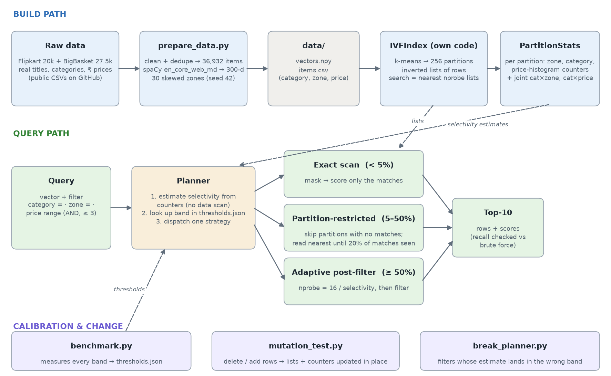

# Madurai Pincode Search

Filtered vector search for the Bharat Bazaar catalogue.

A search is a query vector plus up to three filters joined with AND: category, delivery zone and a price range. It has to return the right top 10 whether the filter matches 95% of the catalogue (Mumbai) or only 10 items (Leh).

The search team had two fixes and each one broke the other case.

- **Post-filtering** searches the 100 nearest items and then drops the ones that can't be delivered. It is fast, but it falls apart when the filter is rare. On my data its recall@10 goes from 0.954 with no filter down to 0.043 when only a handful of items match.
- **Pre-filtering** applies the filter first and then searches what is left. It is always correct, but it scans everything when the filter is broad.

I built my own IVF index and a planner on top of it. The planner uses counters to estimate how many items a filter will let through, without touching the data, and then picks one of three strategies. The cut-off points come from a calibration run, not from guesses.

## Architecture



**Build path**

- `prepare_data.py` downloads two public product CSVs, cleans the titles and removes duplicates, turns each title into a 300 dimension vector with spaCy's free word vectors, and gives each item one of 30 delivery zones using a fixed seed.
- `IVFIndex` (`pincode_search/ivf.py`) runs k-means once with scikit-learn to get 256 centroids. The brief allows this. Everything after that is my own code: the inverted lists, probing the nearest lists, and adding and deleting items.
- `PartitionStats` (`pincode_search/stats.py`) keeps counts for every partition: items per zone, items per category and a price histogram with 48 bins. It also keeps two small joint tables, category by zone and category by price. They are updated on every add and delete, so the planner never has to scan data to make an estimate.

**Query path**

- `Planner` (`pincode_search/planner.py`) estimates the selectivity from the counters, looks up which band that falls in (`results/thresholds.json`) and runs one strategy.
  - **Exact scan.** Build the filter mask and score only the matching rows. Best when few items match.
  - **Partition-restricted.** Skip partitions whose counters say they have no matches. Then read the nearest remaining partitions until 20% of the expected matches have been seen. Best in the middle.
  - **Adaptive post-filter.** Probe `16 / selectivity` partitions and then filter. Best when almost everything matches.
- The two baselines are in `pincode_search/strategies.py` next to the three strategies, so all five go through the same code.

## Setup

You need Python 3.11 or newer. I used 3.12 and 3.13. No API keys are needed.

macOS or Linux:

```bash
python -m venv .venv
source .venv/bin/activate
pip install -r requirements.txt
```

Windows (PowerShell):

```powershell
py -3.12 -m venv .venv
.venv\Scripts\Activate.ps1
pip install -r requirements.txt
```

If PowerShell does not let you run the activate script, run `Set-ExecutionPolicy -Scope CurrentUser RemoteSigned` once. You can also use Command Prompt with `.venv\Scripts\activate.bat`. All the other commands are the same on every system.

`requirements.txt` pins every version, including the spaCy model wheel (about 40 MB from spaCy's GitHub releases).

## Data

I used 36,932 real Indian product listings. They come from the Flipkart 20k sample and the BigBasket catalogue, which are both public CSVs on GitHub. Real titles give real category clusters for free. I made the delivery zones myself with a seed, so I could control the correlations this problem is about.

```bash
python prepare_data.py
# 36932 items, 300 dims, fingerprint 87fa1c169d772067
# bigbasket    24527
# flipkart     12405
```

Both downloads are checked against the SHA-256 of the original file. Some networks cut big downloads at a fixed size. If that happens, the script asks the server for the rest of the file and carries on from where it stopped. If you already have the two CSVs, put them in `data/raw/` as `flipkart.csv` and `bigbasket.csv` and nothing will be downloaded.

The fingerprint is a hash of the vectors and the item table, so you can check that you got exactly the same data as me. `data/sample_items.csv` has 200 rows and is committed, so you can see what the data looks like without running anything.

How I built the metadata:

- **Categories.** 20 categories, mapped from the two source taxonomies. I moved Flipkart's ethnic wear (sarees, kurtas) into its own "Ethnic Wear" category.
- **Zones.** 30 zones with a very uneven spread. The 7 metro zones hold 67% of the items. SHL, IMP, PBL and LEH hold only 10 to 27 items each, which is under 0.1%.
- **Correlation.** Some categories lean towards one region. 55% of Ethnic Wear goes to TN-SOUTH, the Madurai zone. Half of Fresh & Dairy goes to BLR-METRO. Automotive leans to Pune and Jewellery to Surat and Jaipur. Categories already cluster in vector space, so zones end up linked to clusters too.

## Commands

```bash
python benchmark.py       # about 20 s, calibrates the planner and writes results/benchmark.md and results/thresholds.json
python demo.py            # three real text queries where the planner picks three different strategies
python break_planner.py   # the filter that fools the planner, before and after the fix
python mutation_test.py   # deletes 10% of Mumbai, adds 5% new items, writes results/mutation.md
pytest                    # 20 tests for planner choices, estimates, recall and filters
```

`benchmark.py` is the one command that creates every number below. Recall numbers are the same on every run. Latency is not. On my laptop it changed by up to 2 times between sessions, so only compare methods inside the same table.

## Results

Recall@10 is measured against exact brute force search with the same filter. If two items tie on score at position 10, either one counts. Each bucket has 50 queries. A query is a real item's vector with some noise added, taken from the filtered category when there is one.

| Bucket | Post-filter (baseline) | Pre-filter (baseline) | Planner | Planner p95 | Planner picked |
| --- | --- | --- | --- | --- | --- |
| ~100% | 0.954 · 1.24 ms | 1.000 · 2.66 ms | **0.976** · 1.19 ms | 1.95 ms | adaptive post-filter 49, restricted 1 |
| ~10% | 0.738 · 1.02 ms | 1.000 · 1.13 ms | **0.966** · 0.50 ms | 0.73 ms | restricted 49, exact 1 |
| ~1% | 0.336 · 1.04 ms | 1.000 · 0.16 ms | **1.000** · 0.21 ms | 0.33 ms | exact 50 |
| ~0.1% | 0.112 · 0.95 ms | 1.000 · 0.06 ms | **1.000** · 0.09 ms | 0.17 ms | exact 50 |
| handful | 0.043 · 0.93 ms | 1.000 · 0.05 ms | **1.000** · 0.08 ms | 0.12 ms | exact 50 |

Each cell is recall@10 · p50 latency. The full table, with each strategy on its own and p95 for everything, is in `results/benchmark.md`.

The planner stays above 0.95 in every bucket. It wins in two places.

- **~10%, the Mumbai case.** It is more than twice as fast as pre-filtering (0.50 ms against 1.13 ms), because it skips most partitions instead of scanning a tenth of the catalogue.
- **~100%.** It is about 2.2 times faster than pre-filtering (1.19 ms against 2.66 ms), with recall 0.976 instead of 1.000.

Below 5% selectivity, exact scan simply wins. A mask plus a few hundred dot products is faster than walking any index. The planner spends about 0.03 to 0.05 ms on its estimate, which is why its p50 is a little above pre-filtering in the bottom three buckets.

**Crossover.** This comes from the calibration set: 1,500 random filters grouped by their true selectivity. The full table is in `results/benchmark.md`. Every query runs all three strategies one after another, three times each, and keeps the fastest time. That way a slow moment on the machine hits all three equally.

| Selectivity | Exact scan | Partition-restricted | Adaptive post-filter |
| --- | --- | --- | --- |
| 0.05 to 0.1% | **0.05 ms** | 0.17 ms | 0.32 ms |
| 0.5 to 1% | **0.10 ms** | 0.16 ms (recall 0.90) | 0.37 ms |
| 2 to 3.5% | **0.20 ms** | 0.17 ms (recall 0.98) | 0.41 ms |
| 5 to 7.5% | 0.60 ms | **0.25 ms** | 0.80 ms |
| 20 to 30% | 2.42 ms | **0.59 ms** | 1.18 ms |
| 30 to 50% | 2.31 ms | **1.03 ms** (recall 0.99) | 0.92 ms (recall 0.98) |
| 75 to 100% | 2.52 ms | 2.49 ms | **1.05 ms** |

Partition-restricted search looks fast at low selectivity, but its recall drops there (0.90 at 0.5 to 1%). With only a few hundred matches, 20% coverage means it reads very few partitions.

The 2 to 3.5% row was my call. Partition-restricted was a bit faster there, but it was the only band where it won, sitting between two exact scan bands. I smooth out single-band islands like this so the rule stays simple: exact scan below 5%, partition-restricted from 5% to 50%, adaptive post-filter above 50%.

The 30 to 50% row is a tie. Adaptive post-filter is about 10% faster in this run. When I ran the calibration again and again, the winner kept flipping, because the same strategy's time in this band moved by up to 15% from run-to-run. So I treat anything within 15% on speed as a tie, and the strategy with better recall wins it (0.99 against 0.98). Before this rule the boundary jumped between 30% and 50%. With it, 8 runs in a row gave the same bands.

How I picked each setting:

- **nprobe 16.** The smallest value with recall of at least 0.97 and no filter (0.983).
- **20% coverage for partition-restricted.** The smallest value with recall of at least 0.97 in every band from 2% to 50%. At 15% the worst band drops to 0.964.
- **15% tie window.** The run-to-run spread I measured in the closest band. Inside that, speed differences are just noise.
- **Band edges.** The fastest strategy with recall of at least 0.97 on the calibration set, with ties settled by recall. I used 0.97 instead of 0.95 to leave some margin for the test set, which uses different filters and queries.

### Why average recall can look fine while one zone is terrible

| Method | Recall weighted by zone size | Plain average over zones | Worst zone | Worst recall |
| --- | --- | --- | --- | --- |
| post-filter (baseline) | 0.594 | 0.271 | LEH (10 items) | 0.000 |
| planner | 0.985 | 0.995 | BLR-METRO (4,310 items) | 0.970 |

Most traffic comes from the metros, so a dashboard that averages recall over all queries is mostly measuring Mumbai, Delhi and Bengaluru. Post-filtering does fine there and returns nothing at all in Leh. The Madurai customer disappears in the average. That is why I report recall per zone and not only per bucket.

## Three queries, three strategies (`python demo.py`)

| Query | Filter | Estimated / true selectivity | Planner picked |
| --- | --- | --- | --- |
| cotton saree | Ethnic Wear AND TN-SOUTH AND up to ₹1,500 | 0.348% / 0.360% | exact scan |
| wireless bluetooth headphones | MUM-METRO | 16.04% / 16.04% | partition-restricted |
| copper water bottle | up to ₹2,000 | 95.07% / 95.30% | adaptive post-filter |

The Madurai query now returns cotton sarees from Mahek, PerfectBlue and Vipul. All of them are in TN-SOUTH and under ₹1,500, instead of an almost empty page.

## Mutation test (`python mutation_test.py`)

I deleted 592 items from MUM-METRO (10% of the busiest zone) and added 1,817 "Festive Gifting" items (5%). The index had never seen this category. The new items have their own titles, prices from ₹199 to ₹4,999 and a zone mix that leans towards Delhi, Mumbai and Jaipur. Each new item goes to its nearest existing centroid. Nothing is clustered again.

| Stage | ~100% | ~10% | ~1% | new category | Largest partition | Mean item to centroid similarity |
| --- | --- | --- | --- | --- | --- | --- |
| before | 0.972 · 1.04 ms | 0.960 · 0.53 ms | 1.000 · 0.21 ms | n/a | 401 | 0.844 |
| after, incremental | 0.968 · 1.17 ms | 0.970 · 0.54 ms | 1.000 · 0.20 ms | 1.000 · 0.27 ms | 522 | 0.838 |
| after, rebuilt | 0.963 · 0.99 ms | 0.957 · 0.47 ms | 1.000 · 0.22 ms | 1.000 · 0.23 ms | 420 | 0.843 |

What changed:

- **Recall held up.** The counters are updated on every delete and add, so the planner knows straight away that the new category exists and how many Mumbai items are left.
- **The partitions became uneven.** The 1,817 new items went into only 51 of the 256 partitions. The busiest of those took 361 of them, and the largest partition grew from 401 to 522 items. Any query that reads that partition now reads 30% more rows. At this catalogue size the effect on latency is inside the normal run-to-run noise (~100% went from 1.04 to 1.17 ms, ~10% from 0.53 to 0.54 ms). So partition size is the number to watch, not latency.
- **Centroid fit dropped a little** (0.844 to 0.838). The centroids were trained before the gifting items existed.

What I would do about it:

- Watch two numbers: the largest partition compared with the average one, and the mean item to centroid similarity.
- When either one crosses a limit, split only the overloaded partitions (k-means with k = 2 inside each one) instead of rebuilding all 256.
- After a big change in the data, run the calibration again, because the thresholds were measured on a catalogue without that category.

## Where it breaks (`python break_planner.py`)

**The filter:** `category = Snacks & Branded Foods AND price up to ₹200`.

With independent counters, the planner multiplies P(snacks) by P(price up to 200). Snacks are much cheaper than the average item, so it estimates 2.54% when the truth is 5.76%. That puts the filter in the exact scan band, and it runs in 0.68 ms when partition-restricted would take 0.30 ms. The results are still correct, it is just slower than it needs to be. The Madurai filter is an even bigger case. Independent counters estimate 0.006% against a true 0.360%, which is about 60 times too low. It still lands in the right band by luck, because everything under 5% goes to exact scan.

**The fix, now the default:** keep a category by zone table and a price histogram for each category. That is 20 x 30 + 20 x 48 numbers, updated along with everything else. With it, snacks under ₹200 is estimated at 5.72%. Across every category, zone and price combination I tried, wrong band choices dropped from 8 to 1.

**What is left, and why I would leave it:**

1. **Zone and price together.** `zone = BLR-METRO AND price up to ₹200` still lands in the wrong band (4.35% estimated against 5.02% true), because Bengaluru has most of the cheap fresh produce. I could add a zone by price table too, but every new pair is one more table, and correlations between three fields can't be handled this way at all. The failure is "correct but 2 times slower", so I would leave it and log the estimate next to the real count instead.
2. **My weakest point is recall for single filters.** With the fix, the snacks filter correctly goes to partition-restricted search, and its recall is 0.943. I chose 20% coverage using band averages, and this one category is below its band's average. It is the same trap as the zone table above: averages hide single filters. Raising coverage to 30% lifts the worst band to 0.986, but costs about 35% more time in the middle bands (0.64 to 0.85 ms).

## Design decisions and trade-offs

- **IVF instead of a graph index.** Partitions give me a natural place to keep counters, and that is what makes partition-restricted search possible. A graph index has nothing to attach per region counts to, and filtered graph search needs its own fixes for parts of the graph that get cut off.
- **256 partitions for 37k items**, about 144 items per list. Fewer, bigger lists make the counters less precise. More lists means probing costs more than it saves at this size.
- **Thresholds are bands, not one cut-off.** My first version assumed "exact below X, post-filter above Y". The measurements did not look like that, so the rule is now a table of measured bands.
- **Strategies are timed side by side.** My first calibration timed each strategy over the whole band, one after another, and the bands came out different on different runs. Timing all three on the same query back to back, and keeping the best of three, fixed most of that.
- **Calibration target 0.97, test target 0.95.** The calibration and test sets use different seeds. The gap is what keeps every test bucket above 0.95.
- **Word vectors, not a sentence model.** spaCy's averaged word vectors are weaker than a sentence transformer. But they install from GitHub without a model hub, and the whole data prep runs in under 10 seconds. The search code does not care where the vectors come from.

## Known limitations

- At 37k items, brute force takes 1 to 3 ms, so the planner is only about 2 times faster than pre-filtering in the ~10% and ~100% buckets. The "5 times slower" pre-filter in the brief needs a much bigger catalogue. The crossover table shows where I expect the gap to grow.
- All timings are single-threaded Python and NumPy on one laptop, and they changed by up to 2 times between sessions. Compare methods inside one table, not across runs. About 0.03 to 0.05 ms of every number is Python call overhead.
- Averaged word vectors ignore word order and miss words that are not in the vocabulary. For example, "copper water bottle" gives two different bottles a score of 1.000 because their known words are the same.
- Each item has one zone. Real delivery depends on the pincode and the date ("by Friday"). Here a zone stands in for both.
- Deletes happen in place, but the k-means centroids never move unless the index is rebuilt.

## What I used AI for
I used AI only to learn concepts such as IVF indexes and selectivity.

## Repository layout

```
prepare_data.py          download, clean, embed, assign zones
benchmark.py             calibration and result tables (one command)
demo.py                  three named queries
break_planner.py         failure case, before and after the fix
mutation_test.py         deletes and a new category
pincode_search/
  catalog.py             items, filters, masks
  exact.py               brute force ground truth
  ivf.py                 the index
  stats.py               counters and selectivity estimates
  strategies.py          three strategies and two baselines
  planner.py             decision rule
  workload.py            query sets per selectivity bucket
  bench.py               timing and calibration
  metrics.py             recall@10, percentiles
tests/                   planner, estimates, recall, filters
results/                 generated tables and thresholds
docs/architecture.png
```
